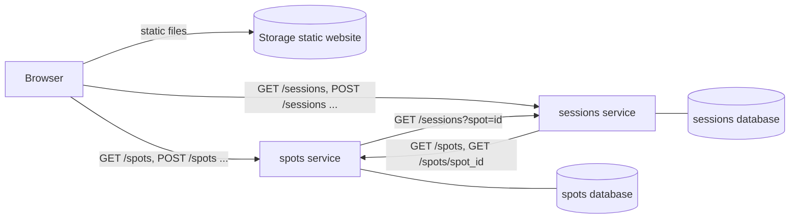
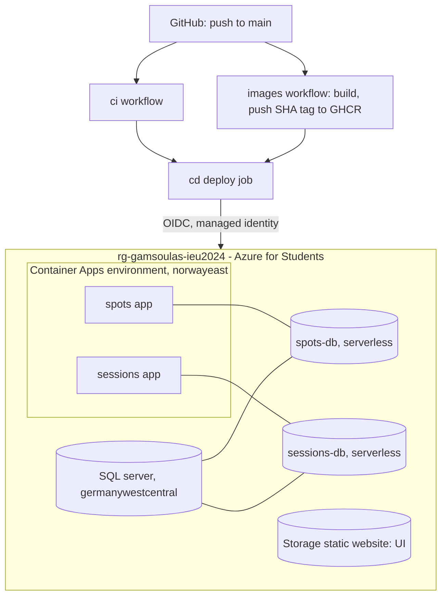

# SwellSync — Assignment 2 report

Split system on Azure: a spots service, a sessions service, one database each, a static UI, and a pipeline that deploys from `main`. Live at https://gamsoulasieu2024ui.z1.web.core.windows.net. Source and history: https://github.com/gustaveems/swellsync. Decisions are in `ADR.md` (ADR-006 to ADR-010).

## 1. Architecture

The Assignment 1 monolith had two domains behind one SQLite file. ADR-002 had already put a seam between them: the spots code never reads sessions, and sessions refer to spots only by `spot_id`. Assignment 2 puts that seam on the network (ADR-006).

Two calls cross the seam and nothing else. The sessions service asks spots for names to show in a list and checks that a spot exists before it writes a session. The spots service asks sessions whether a spot still has sessions before it deletes the spot. Every call has a 2-second timeout. `sessions.spot_id` has no foreign key, because the table it points to is in another database; the check in code replaces it, and a race is possible between the check and the write (ADR-007 accepts it for one user).

`system.yaml` states all of this in the course format and passes the course schema. The contract tests compare it with the OpenAPI documents and with the routes the running apps serve, in both directions, and they found one real mismatch on their first run (a path parameter named `{id}` in one file and `{spot_id}` in the other).

## 2. Deployment

Each service is a Container App with 0 to 1 replicas, so the system costs almost nothing when idle. Each has its own serverless database on the free offer and its own contained SQL user, which reaches only its own database and can run migrations. The connection string is a Container App secret. The UI is a Storage static website, and each service allows only that origin through `ALLOWED_ORIGIN` (CORS is handled in the service, as the course guide requires).

The pipeline signs in with a user-assigned managed identity through OIDC, so no Azure password or service principal is stored in GitHub. The identity has Contributor on the resource group only, with federated credentials for `refs/heads/main`. ADR-008 records the design. The README lists every setup command, without passwords.

Two things went differently from the plan, and both are in ADR-008. Norway East refused to create a SQL server on this subscription, so the server is in Germany West Central. And I first deployed into the IE group subscription, which the guide reserves for the group project. I rebuilt in my own Azure for Students subscription and deleted what I had made in the IE one.

## 3. Data and migrations

Each service has numbered SQL files applied at startup by a small runner (`db.py`). Each file runs in its own transaction and is recorded in `schema_migrations`, so a second boot applies nothing. Migrations are forward-only, and recovery from a bad one is point-in-time restore plus redeploying the previous image by its commit SHA (ADR-007).

**Migration 002** changes a table that holds data: `sessions.updated_at`. It adds the column as NULL, copies `created_at` into every existing row, then makes the column NOT NULL with a default. Nothing is dropped or deleted. I ran it on SQL Server 2022 from the compose stack, in a separate project:

| Step | Result |
|---|---|
| Boot with 001 only | 6 seeded sessions, `schema_migrations` has 001 |
| Add 002 and restart | log: `migration applied: 002_sessions_updated_at.sql` |
| Rows after | 6 of 6 backfilled, `updated_at = created_at` for all |
| Column | `updated_at` NOT NULL, default `df_sessions_updated` |
| Edit session 1 through the API | `updated_at` moved from 17:25:55 to 17:26:11, `created_at` unchanged |
| Third boot | log: `migrations: nothing to apply` |

The raw output is in `docs/evidence/migration-002.md`, and `services/sessions/tests/test_migrations.py` pins the same behaviour in CI.

## 4. Partial failure

The services are written so that one being down does not take the other with it, and so that a failed call never leaves half a write behind.

| Situation | What the user gets | Tested by |
|---|---|---|
| Session list, spots unreachable or slow | The sessions still load, with `spot_name` null and a `notice` | `test_list_degrades_with_a_notice_when_spots_is_unreachable`, `test_list_gives_up_on_a_slow_spots_within_the_timeout` |
| Create or edit a session, spots unreachable | 503, nothing stored | `test_create_is_503_and_stores_nothing_when_spots_is_unreachable`, `test_update_is_503_within_the_timeout_when_spots_is_slow` |
| Create a session for an unknown spot | 422 | `test_create_refuses_a_spot_the_spots_service_does_not_know` |
| Delete a spot that still has sessions | 409 | `test_spot_delete_is_409_when_sessions_still_reference_it` |
| Delete a spot, sessions unreachable or slow | 503, the spot is kept | `test_spot_delete_is_503_when_sessions_is_unreachable`, `test_spot_delete_is_503_within_the_timeout_when_sessions_is_slow` |
| Database paused or unreachable | `/health` returns 503, and requests return 503 instead of a stack trace | unit tests with a database that is switched off |
| Cold start after an idle period | The UI retries GETs and shows "starting up"; writes are never retried | tested with a mocked `fetch`; see below |

These are the 12 cross-seam tests. They run the two real apps against each other over HTTP, with a real stub server on 127.0.0.1, so the timeouts and refused connections behave as they do between containers. The databases in unit tests are in-memory fakes that reject any SQL they do not recognise, so a new query fails a test instead of passing silently.

The cold start matters on Azure: after an hour idle the free-offer database pauses, and the first request can take about a minute. The service connects with retries and backoff (`db.py`). Azure itself answers the first request with 503 "App port is not ready". The UI treats a 503 or a network failure on a GET as "waking up", shows a notice, and retries for up to about 90 seconds. It never retries a write, so a POST cannot be applied twice.

## 5. Pipeline

Four jobs run on every pull request and on every branch except `main`: lint, unit tests for each service (with a 70% coverage floor), the cross-seam integration suite, and the contract checks. On `main`, `cd.yml` calls the same CI and the image build, and only then deploys. A test keeps the check names in `ci.yml` in step with the `Main` ruleset, which requires all five checks.

Measured at the end: spots 39 tests, 82% coverage; sessions 58 tests, 84%; 12 integration tests; 13 contract tests, including the course schema.

**A failed run and its fix.** To show the gate working, I broke the contract on a throwaway branch (`evidence/failed-then-fixed`, never merged): `system.yaml` named the spot path `{id}` while the OpenAPI document says `{spot_id}`.

| | Commit | CI result |
|---|---|---|
| Broken | `18e8335` | `contracts` failed, run 45051801890. Lint, both unit-test jobs and integration passed |
| Fixed | `5a05243` | `ci` passed on all five checks, run 45051902632 |

**The first deploy from `main`, which also failed.** Merging PR 2 started the `cd` run 45051869246. CI and the image build passed inside it, the OIDC sign-in worked, and both Container Apps were updated to the merge commit `71d8092`, which also applied migration 002 on the Azure database. Then the `deploy` job failed at the UI upload. The cause was my own: the job used `$UI_STORAGE` but never defined it, so the storage account name was empty. The step before it had read the UI origin from that same empty name and set `ALLOWED_ORIGIN` to an empty string on both services, which would have blocked the UI through CORS. I set the variable back by hand, then fixed the workflow in PR 3: the job now defines `UI_STORAGE`, and it stops if the origin it reads is not an `https://` address. The `cd` run started by merging PR 3 is the green deploy from `main`; its run id is recorded in `docs/evidence/first-green-deploy.md`.

## 6. What is not done, and why

* **No authentication** (ADR-010). Anyone with a service URL can change the data. CORS limits browsers, and parameterised queries and validation limit what a direct request can do, but it is not access control. This is a deliberate omission for a single-user demo, and the ADR names what the next step would be.
* **One replica per service**, so a deploy takes a service down briefly and nothing scales out. The migration runner would need a lock first (ADR-007).
* **The SQL server is in another region** from the apps, which adds latency to every query.
* **The contained SQL users are created by hand**, following the README. No pipeline step does it.
* **The seam race** between the spot check and the session write is accepted (ADR-007).
* **My own mistakes.** I deployed first to the wrong subscription, an empty password went into the first connection strings (the services failed at boot with error 18456 until I fixed the secrets), and I needed a second sign-in to find the right subscription. The README records these.
